# Solar Filament Segmentation Challenge 2026

**H9b achieved public Panoptic Quality 0.39, and is selected for the final Kaggle score.**
This repository contains the source, trained weights, evaluation evidence and final technical report for Francisco Angulo de Lafuente's entry.

## Final evaluation package — 13 November 2026

| Material | Link and verified scope |
| --- | --- |
| Technical report | [Four-page PDF in the official ACM sigconf format](docs/submission/TECHNICAL_REPORT_4P_20261113.pdf) and [complete editable source](docs/submission/TECHNICAL_REPORT_4P_20261113_SOURCE.zip). |
| Public inference notebook | [Original JPEGs to COCO-RLE CSV](notebooks/h9b_clean_raw_jpeg_to_csv.ipynb), with CPU as the portable default and optional explicitly selected CUDA. |
| Original detector weights | [FP32 shard manifest](release/models/fp32_shards/manifest.json), reconstructed and checked before inference. Other released weights have [SHA-256 signatures](release/model_metadata/WEIGHTS_SHA256SUMS.txt). |
| Current code validation | [P105 portability and resume-integrity audit](docs/submission/P105_PORTABLE_RELEASE_AUDIT_20261113.md): 23 CPU regression tests passed; eight notebook code cells compile. |
| Exact accepted-artifact replay | [P94 receipt](docs/submission/P94_TRUE_UPLOAD_EXACT_PARITY_RECEIPT_20261113.json): 1,241/1,241 identical RLE rows from frozen no-site crops and the original refiners. |
| Organizer form | Materials prepared; submission and receipt are tracked separately from the Kaggle result. |

The accepted artifact is Kaggle submission **58112557**, filename `submission_h9b_nosite.csv`, submitted on 8 November 2026. On 13 November the authenticated Kaggle page confirmed **Complete**, **0.39**, and **one final selection out of one available**. Its SHA-256 is:

```text
24b3ea1c8e151c3053c69e61bc3d0a0a09bd7171fe82c95f7c109ce407efdc60
```

### What the model does

Four native-resolution **ResNet34 U-Nets** preserve fine semantic detail. Four **Mask R-CNN** models supply object proposals. A frozen TRAIN-derived selector, without observatory or date features, chooses instances; **ResNet34 and EfficientNetV2-S crop refiners** refine their geometry. The final assembly assigns each pixel to at most one predicted instance and produces compressed COCO RLE.

Inference uses the organizer-supplied individual H-alpha image. Test labels, manually inferred annotations and neighboring frames are not inference inputs.

### Running the public pipeline

Clone the full repository, install the pinned [requirements](requirements.txt), and download the official competition data under its terms. The default image directory is `data/MAGFiLO_1.0_Kaggle_2026/test/test_images`. Open [the public notebook](notebooks/h9b_clean_raw_jpeg_to_csv.ipynb) from this checkout.

The notebook runs on CPU by default and writes to `outputs/h9b_public_cpu`; it checks for 20 GiB of available disk space. Other locations can be selected with `SOLARFIL_TEST_IMAGES` and `SOLARFIL_REPLAY_OUT`. For optional CUDA, set `SOLARFIL_DEVICE=cuda` and, when multiple devices are visible, `SOLARFIL_GPU_UUID` to the chosen local index or UUID. Existing GPU compute jobs and visibility restrictions are respected. The two refiners remain on CPU FP32 to preserve the documented inference policy.

Original FP32 detector checkpoints are assembled from published shards. No private caches, remote model service or retraining is required by the new public notebook. Output contracts bind images, model weights, selector metadata, source code and backend. A normal Jupyter autosave does not invalidate a run; changes to executable cells or scientific inputs do.

```bash
python -m pip install -r requirements.txt
python -m unittest discover -s tests -p test_public_replay_runtime.py -v
python scripts/preflight_h9b_clean_notebook.py --root . --full-hash
```

### Evidence and remaining numerical scope

**The accepted 0.39 and the current public rebuild are distinct artifacts.** P94 proves exact replay from historical frozen crops. The upstream JPEG reconstruction and P102 pilot show numerical differences, and the public notebook defines a model-only fallback that differs from the historical control branch. Whether that branch was used in the genuine accepted file has not been established here.

P105 validates code portability, interfaces and integrity contracts; it does not execute the full 180-image model inference. The rebuilt CSV must not inherit the accepted artifact's score or an exact-equivalence claim without its own completed evaluation. This boundary is explained in the report and notebook.

### Scientific record

Local validation groups annotators of the same physical image and uses temporal exclusions. Calibration results, held-out results and public Kaggle scores are reported separately. Positive and negative ablations remain available, including the [small-instance study](docs/2026-11-12-paired-small-instance-sampling.md), [cross-fold P84 analysis](docs/submission/P84_CROSSFOLD_MATCHED_PQ_SUMMARY_20261112.md), and [submission provenance correction](docs/submission/P93_ACTUAL_UPLOAD_PROVENANCE_CORRECTION_20261113.md).

### Attribution and license

**Francisco Angulo de Lafuente** · [ORCID 0009-0001-1634-7063](https://orcid.org/0009-0001-1634-7063) · [CITATION.cff](CITATION.cff).
Original software is licensed under [MIT](LICENSE). Upstream components retain their own notices. Competition images, annotations and derived scientific figures remain subject to their source terms and attribution; they are not relicensed by the code license.

---

<details>
<summary>Historical project notes and earlier validation records</summary>

The following dated notes preserve earlier evidence. The final-package section above supersedes historical delivery-status statements; individual scientific claims retain their original scope.

**Reproducibility milestone (13 November 2026):** [P94 independently verifies exact byte-for-byte equality](docs/submission/P94_TRUE_UPLOAD_EXACT_PARITY_RESULT_20261113.md) between the **genuine Kaggle-uploaded CSV** (submission 58112557; SHA-256 `24b3ea1c…`) and a new CPU FP32 replay from frozen H9b no-site crops and both refiner checkpoints: **1,241/1,241 identical RLE rows**. This corrects P91's comparison to a misleadingly named intermediate. [P79/P80 fourfold H3 replay](docs/submission/P79_P80_FOURFOLD_H3_REPRO_AUDIT_20261112.md) separately verifies earlier detector stages. **End-to-end reconstruction from the original JPEG images remains an open reproducibility task**, and the organizer's mandatory final Google Form has no verified submission receipt. No new Kaggle submission or score is claimed. [Executable CPU FP32 H9b replay notebook](notebooks/h9b_true_upload_cpu_fp32_replay.ipynb) is published, with explicit assertions and SHA-256 gates; it still requires frozen no-site crop inputs from the competition pipeline.


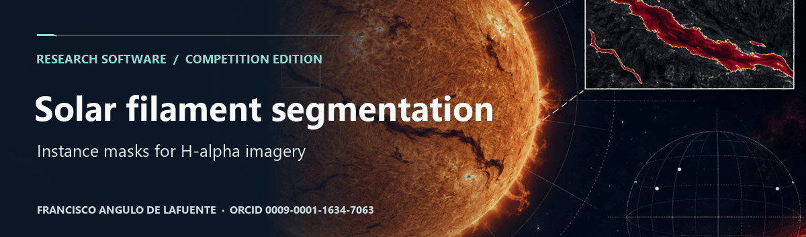


**Project citation:** [Francisco Angulo de Lafuente](https://orcid.org/0009-0001-1634-7063) · [CITATION.cff](CITATION.cff) · [Software metadata](codemeta.json).


**Verified competition status (12 November 2026):** the highest accepted public Kaggle score is **0.39 Panoptic Quality**, submission [58112557](https://www.kaggle.com/competitions/filament-segmentation-2026/leaderboard), using the pixel-only H9b pipeline (8 November 2026). The earlier 0.35 figure in the historical 28 October results below is not the current best. A new 3,600-step single-GPU small-filament sampling ablation completed with **+0.0110 local PQ** versus its matched semantic-model control (95% CI +0.0048 to +0.0168), but **−0.0915 local PQ** versus the stronger H9b baseline and therefore **did not pass the promotion gate**. [Full negative-result and evidence report](docs/2026-11-12-paired-small-instance-sampling.md). No higher official score is claimed.


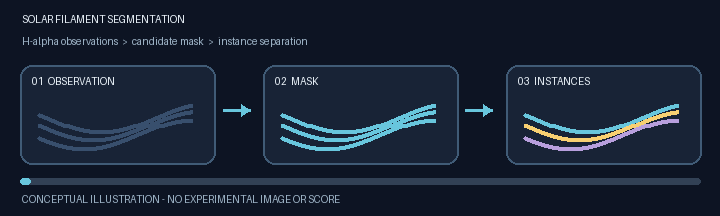

*Conceptual, animated workflow illustration only: synthetic curves show observation → candidate mask → separated instances. This is **not** a telescope image, model output, measured metric or leaderboard result. [Static PNG alternative](assets/filament-workflow-concept.png) · [Generation script](scripts/generate_readme_animation.py).*

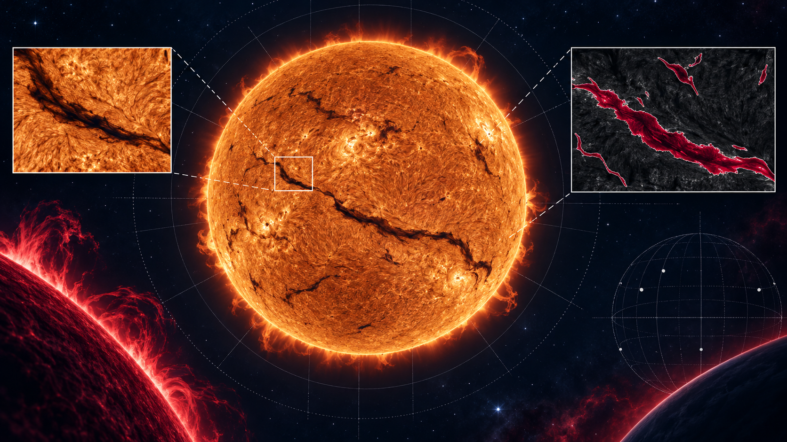

An open-source preparation and evaluation pipeline for the [Solar Filament Segmentation Challenge 2026](https://www.kaggle.com/competitions/filament-segmentation-2026). The project focuses on precise, instance-aware masks for H-alpha observations and audits fragmentation, over-merging, and runtime because the challenge uses Panoptic Quality rather than a plain pixel-overlap score.

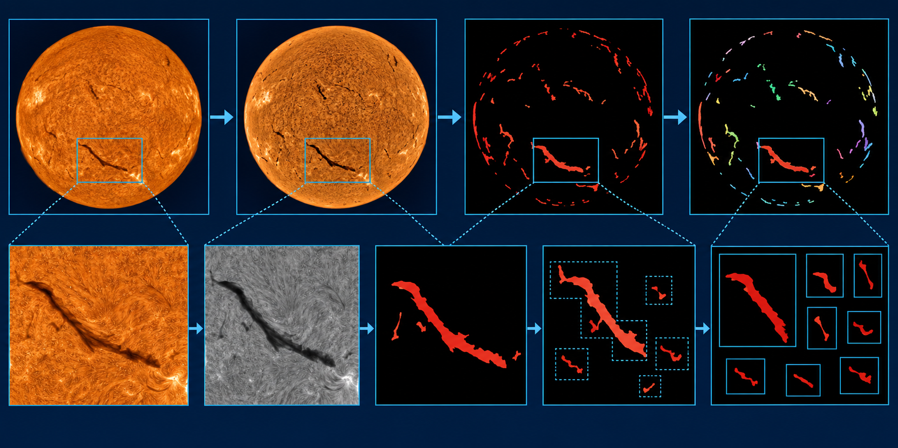

<!-- impact-note:start -->
<sub><strong>Efficiency and practical value.</strong> The repository reports an evaluator fix reducing retained polygon buffers from 156 MiB to 0.424 MiB on three real annotation records while preserving PQ, TP, FP and FN exactly. This avoids retaining full image arrays for small crops and supports more memory-conscious evaluation. The <a href="pipeline/results/memory_fix_verification.json">recorded comparison</a> concerns array buffers, not whole-process memory, energy consumption or improved model accuracy.</sub>
<!-- impact-note:end -->

## 28 October: real training results and an applied memory fix

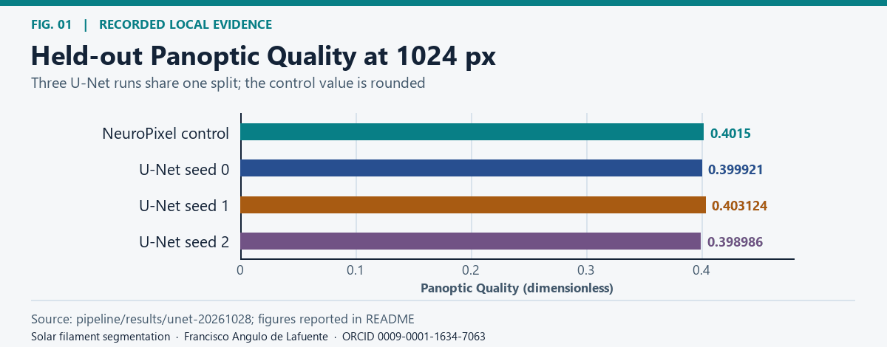

*Held-out Panoptic Quality at 1024 px.* [Static figure](docs/figures/fig-01.png).


The executable NeuroPixel-compatible pipeline is now published under
[`pipeline/`](pipeline), including the temporal split, training, native and
1024-resolution PQ, calibration-only model selection and submission inference.
The comparison control is NeuroPixel (calibration mean PQ1024 0.4052, held-out
test 0.4015), rather than the older ridge baseline below.

| U-Net ResNet34, ImageNet initialisation | Calibration PQ1024 | Test PQ1024 | Test native PQ |
|---|---:|---:|---:|
| Seed 0, recovered checkpoint | 0.415397 | 0.399921 | 0.387129 |
| Seed 1 | 0.419251 | **0.403124** | 0.386943 |
| Seed 2 | 0.421140 | 0.398986 | 0.382741 |

Calibration improves for all three trained seeds. Seed1 also improves the
held-out control by +0.001624; seed2 regresses by -0.002514. Both outcomes
are preserved. The completed three-seed mean is **0.400677 ±0.002170**
(sample SD), compared with the reported control0.4015; the mean delta is
-0.000823. This does not pass the replacement gate; no new leaderboard
submission is claimed. The official API still returns five entries with best
public PQ **0.35**. [Actual run records](pipeline/results/unet-20261028).

**Applied evaluator improvement:** NumPy bounding-box slices kept a complete
2048-square mask alive for each polygon. Crops now own their small buffers,
ground truth is rasterised as needed, and prediction caches are released after
the last annotation of each physical image. On the first three distinct real
annotation records, retained polygon buffers fall from **156 MiB to 0.424 MiB**;
PQ1024, native PQ, TP, FP and FN are exactly unchanged. This measures retained
array buffers, not whole-process RSS or model accuracy.
[Checked equivalence and byte counts](pipeline/results/memory_fix_verification.json).

The original seed0 log ends in `Killed` after8000training steps; that log does
not prove the operating system's reason. A recovery command evaluates its
already-saved best checkpoint without retraining and preserves the original
incomplete record. It explicitly matches the original T4 float16 inference
precision when run on the managed RTX3090. That recovery has now succeeded,
without retraining; the [checkpoint hash, complete evaluation and three-seed
summary](pipeline/results/unet-20261028) are published. Seeds1/2 were evaluated
on T4 and seed0 on RTX3090, so matched precision is not a claim of identical
hardware. All three seeds improve calibration over the reported control0.4052,
while only seed1 improves the held-out test. These gains and regressions are
retained together. The published control is rounded and the three seeds share
one split; no confidence interval across independent test datasets is inferred.

## Repository contents

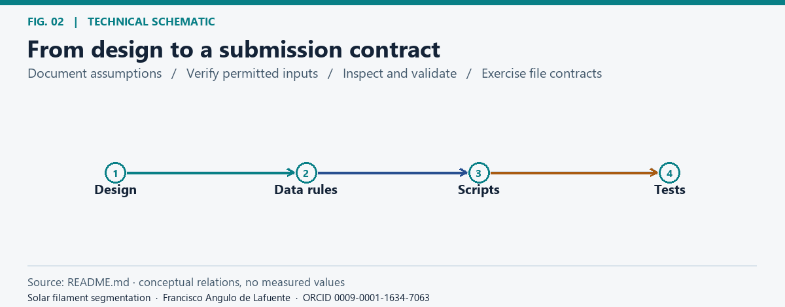

*From design to a submission contract.* [Static figure](docs/figures/fig-02.png).


- `PIPELINE_DESIGN.md` — reproducible design and assumptions.
- `RULES.md` — competition constraints and final-deliverable checklist.
- `scripts/` — inspection, validation, and submission helpers.
- `tests/` — contract tests that run without private competition data.
- `experiments.csv` — an auditable record of local experiments.

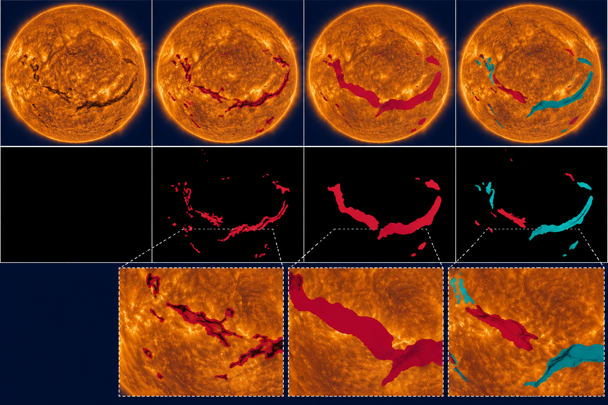

## Recommended workflow

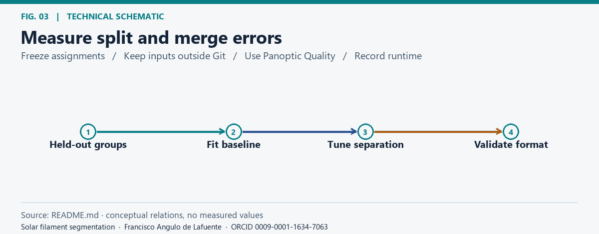

*Measure split and merge errors.* [Static figure](docs/figures/fig-03.png).


1. Download official data from Kaggle into an external ignored data directory.
2. Establish a deterministic train/validation split and preserve provenance.
3. Compare a strong segmentation baseline against morphology-aware post-processing.
4. Tune instance separation on Panoptic Quality, not Dice alone.
5. Validate submission format and runtime before upload.

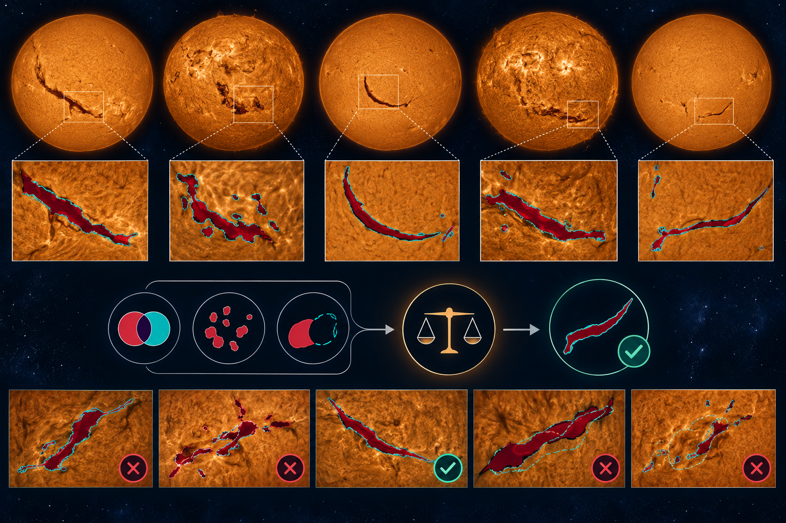

## Scientific limits

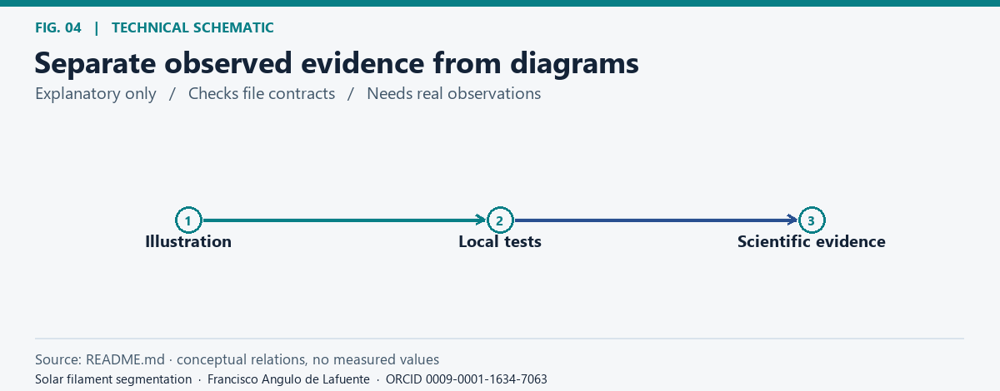

*Separate observed evidence from diagrams.* [Static figure](docs/figures/fig-04.png).


This is a competition engineering scaffold, not a solar-physics validation study. Generated figures are explanatory artwork, not observations. No competition images or labels are redistributed here.

## License

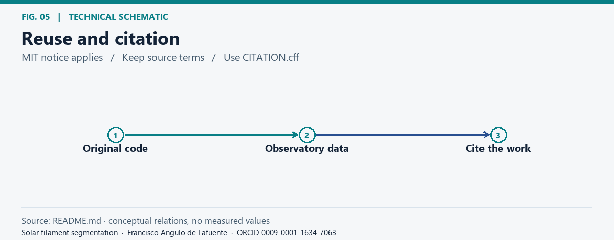

*Reuse and citation.* [Static figure](docs/figures/fig-05.png).


MIT for the original code. See [LICENSE](LICENSE). Dataset and observatory material remain under their source terms.

## Bibliography and research directions

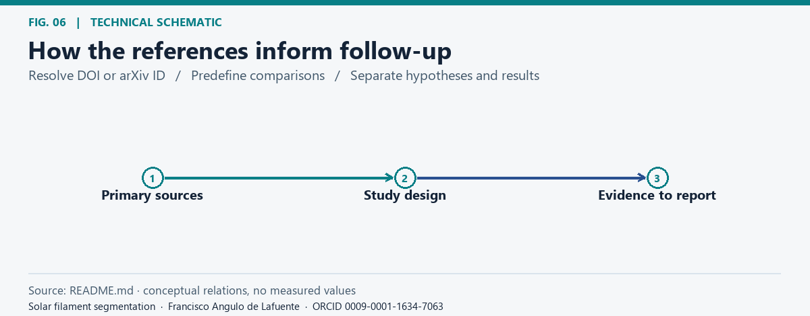

*How the references inform follow-up.* [Static figure](docs/figures/fig-06.png).


The following primary sources inform proposed checks. Their text, code, figures, and data are not included in this documentation update.

- [Kirillov et al. (2019), Panoptic Segmentation](https://arxiv.org/abs/1801.00868). Report segmentation and recognition components alongside Panoptic Quality to diagnose merging and fragmentation.
- [Ronneberger et al. (2015), U-Net](https://arxiv.org/abs/1505.04597). Use a fixed encoder–decoder baseline before attributing gains to instance-aware post-processing.

**Attribution and reuse.** Please credit [Francisco Angulo de Lafuente](https://orcid.org/0009-0001-1634-7063) in academic and software reuse and do not present this work as your own. When distributing copies or substantial portions of the original MIT software, preserve the copyright and permission notice. Upstream material keeps its own terms. [License](LICENSE) · [Figure methods and provenance](docs/figures/README.md).

<!-- research-provenance: project=solar-filament-segmentation-2026; date=2026-11-04; author=Francisco Angulo de Lafuente; orcid=https://orcid.org/0009-0001-1634-7063; original-software-license=MIT -->

## November 2026 submission evidence and report

The verified best official submission is **58112557**, which scored **public Panoptic Quality 0.39** on 8 November 2026.

- [Four-page technical report (PDF)](docs/submission/TECHNICAL_REPORT_4P_20261112.pdf) — an evidence-based scientific report, not proof that the final organizer form was submitted.
- [H9b GPU reproducibility and true uploaded CSV parity audit](docs/2026-11-12-h9b-replay-precision-and-submission-parity.md) — distinguishes the accepted Kaggle upload from intermediate stage-two artifacts, and quantifies small numerical differences.
- [H9b frozen-intermediate audit notebook](notebooks/h9b_stage2_intermediate_replay.ipynb) is published and its code cells passed syntax validation. It replays **frozen model predictions to an intermediate CSV only**. The intermediate SHA-256 (`67f02e4d...`) is **different** from the actual accepted Kaggle upload SHA-256 (`24b3ea1c...`); additional staged assets are required and a public clean-checkout execution has **not** yet been verified.
- The full release still requires a self-contained end-to-end notebook with all legally distributable weights and a clean-checkout verification. Do not claim exact byte-identical reproduction of the accepted artifact from intermediate files.


## Scientific reproducibility update (12 November 2026)

The public release now provides the exact original [native U-Net source](release/source/native_model.py),
a [replay CLI](scripts/replay_h3_from_original_images.py) and a
[raw-image-to-H3-map notebook](notebooks/h3_public_raw_image_replay.ipynb).
An independently executed [one-image smoke test](docs/submission/P76_PUBLIC_SOURCE_H3_RESULT_20261112.md)
demonstrates native map reconstruction from original unlabeled Kaggle test pixels.
The complete accepted-CSV reproduction remains **unverified**.

The [F1 held-out PQ audit](docs/submission/F1_HELDOUT_P75_NEGATIVE_20261112.md)
documents a negative result for the experimental small-filament sampler.
No additional Kaggle submission has been justified. These local metrics
must not be confused with the accepted leaderboard PQ 0.39 (ID 58112557).
The [four-page report](docs/submission/TECHNICAL_REPORT_4P_20261112.pdf) is
available, but final Google Form submission **is not yet confirmed**.


### Original FP32 Mask R-CNN restoration (P85, 12 November 2026)

The repository now contains **eight SHA-256-verified shards of the four original FP32 detector checkpoints**. Unlike the earlier FP16 export, these shards restore the original training checkpoints **bit-for-bit**, without Git LFS or a proprietary model host. The Python standard-library assembler rejects modified shards, unsafe paths and unexpected outputs.

Run `python scripts/reassemble_maskrcnn_fp32.py --check-only` and then `python scripts/reassemble_maskrcnn_fp32.py --output-dir /path/to/large/HDD/weights`. The validation includes four passing synthetic safety tests and a real F1 original-model restore matching SHA-256 `399b4bd790c5acf88f32da926dd00a9ac4b704040241b8b0899117c687756820`. See [P85 full scientific release audit](docs/submission/P85_FP32_CHECKPOINT_RELEASE_20261112.md).

**Limit:** Original detector checkpoint reproducibility is not the same as byte-exact reproduction of the 1,241-row accepted H9b CSV. The full notebook and mandatory final Google Form still need independent completion and confirmation.

</details>
