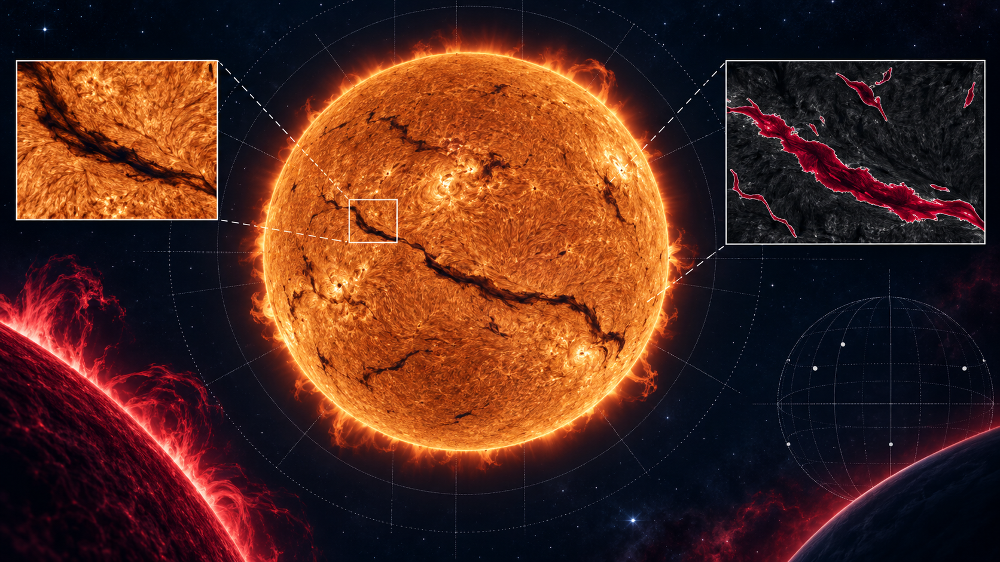
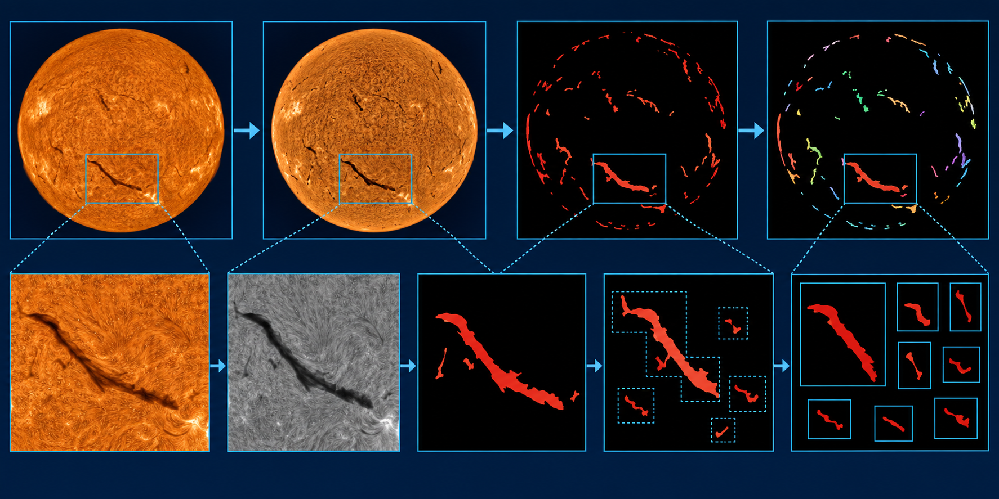
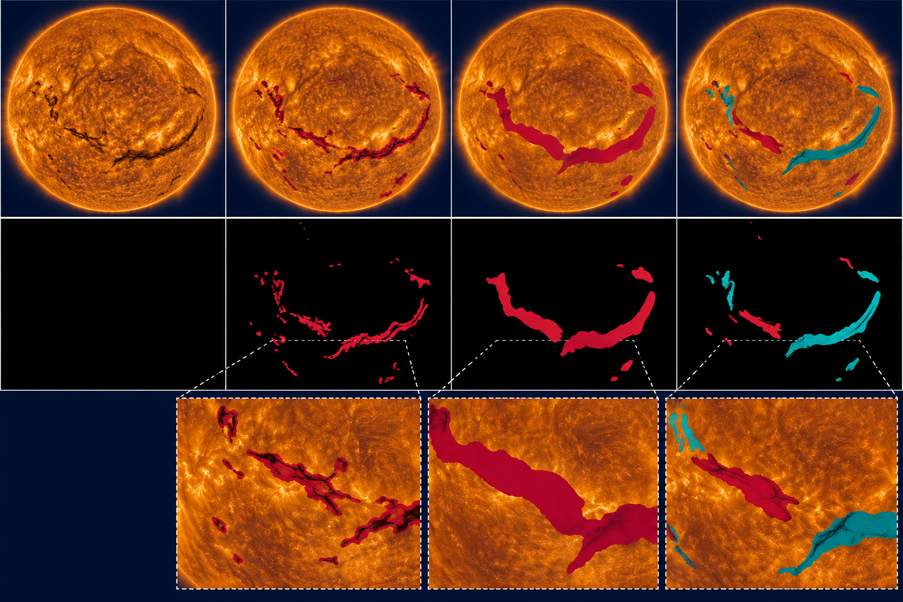
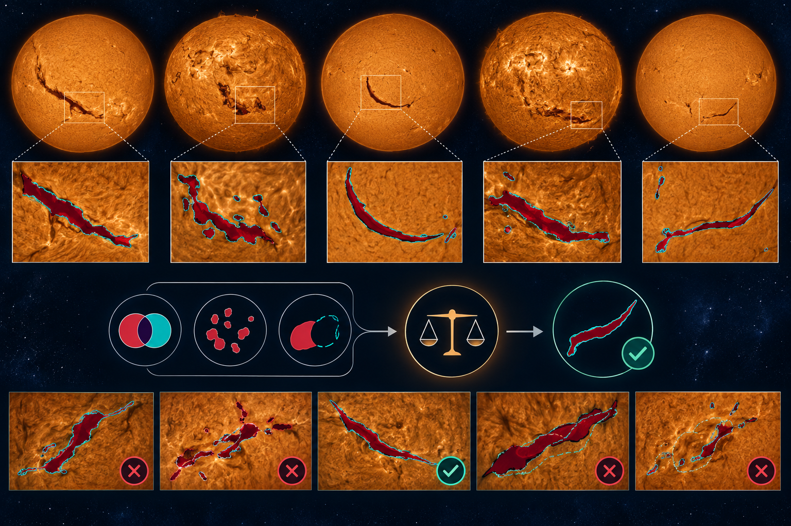

# Solar Filament Segmentation Challenge 2026

An open-source preparation and evaluation pipeline for the [Solar Filament Segmentation Challenge 2026](https://www.kaggle.com/competitions/filament-segmentation-2026). The project focuses on precise, instance-aware masks for H-alpha observations and audits fragmentation, over-merging, and runtime because the challenge uses Panoptic Quality rather than a plain pixel-overlap score.

## Repository contents

- `PIPELINE_DESIGN.md` — reproducible design and assumptions.
- `RULES.md` — competition constraints and final-deliverable checklist.
- `scripts/` — inspection, validation, and submission helpers.
- `tests/` — contract tests that run without private competition data.
- `experiments.csv` — an auditable record of local experiments.

## Recommended workflow

1. Download official data from Kaggle into an external ignored data directory.
2. Establish a deterministic train/validation split and preserve provenance.
3. Compare a strong segmentation baseline against morphology-aware post-processing.
4. Tune instance separation on Panoptic Quality, not Dice alone.
5. Validate submission format and runtime before upload.

## Scientific limits

This is a competition engineering scaffold, not a solar-physics validation study. Generated figures are explanatory artwork, not observations. No competition images or labels are redistributed here.

## License

MIT for the original code. See [LICENSE](LICENSE). Dataset and observatory material remain under their source terms.
