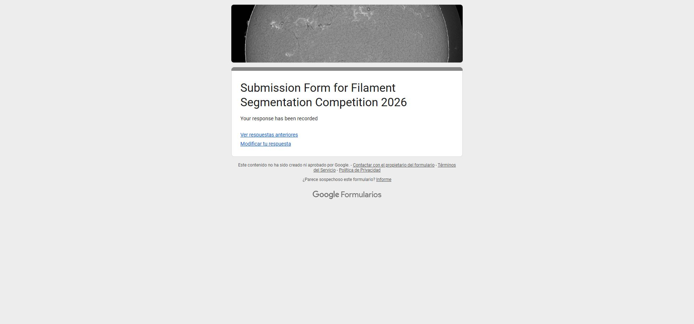
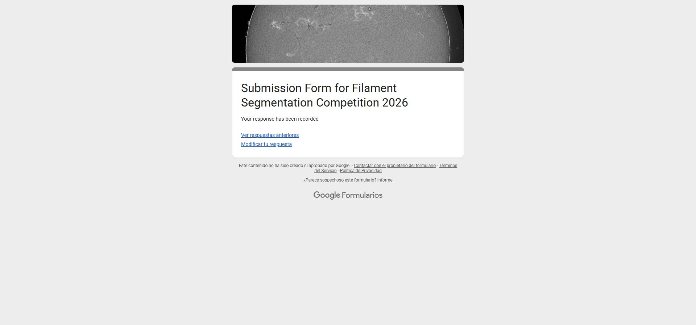

# Organizer submission receipt — 13 November 2026

Author: Francisco Angulo de Lafuente · ORCID 0009-0001-1634-7063

The official **Submission Form for Filament Segmentation Competition 2026** was submitted on **13 November 2026 at 14:00:23 UTC (15:00:23 Europe/Madrid)**.

Two independent delivery signals were verified: the browser displayed **“Your response has been recorded”**, and Google Forms sent an email receipt containing the submitted answers and both uploaded files. The timestamp above comes from the receipt email. This confirms receipt of the materials; it is not a judging result or an eligibility determination.

## Latest report revision

The same organizer response was updated at **14:11:57 UTC (15:11:57 Europe/Madrid)** on 13 November. The confirmation page and a second email receipt both verified **revision R2**, which includes the completed P103 stage audit. Its submitted filename is `SolarFilament_TECHNICAL_REPORT_4P_20261113_R2.pdf`; SHA-256 is `8f75a47996fa7e6e5f37f5d8e85a6cf5b64033701507782a54a81d786e5ed9f5`.

The form does not allow previously submitted uploads to be edited or removed. R2 was therefore added as a clearly named revision within the existing response, alongside the original report. The accepted CSV and the participant details remained unchanged. The repository at this update was `0159f0ff8752997407e19061d2a79c16b6a61d29`.

## Original submission materials

| Material | Verified record |
| --- | --- |
| Kaggle artifact | `submission_h9b_nosite.csv`, accepted submission **58112557**, public PQ **0.39**. |
| Uploaded CSV name | `SolarFilament_58112557_submission_h9b_nosite.csv`. Google Forms adds the uploader name to its stored filename. |
| CSV SHA-256 | `24b3ea1c8e151c3053c69e61bc3d0a0a09bd7171fe82c95f7c109ce407efdc60` |
| Technical report | `TECHNICAL_REPORT_4P_20261113.pdf`, four pages, ACM sigconf format. |
| Uploaded report name | `SolarFilament_TECHNICAL_REPORT_4P_20261113.pdf`. |
| Report SHA-256 | `6a289170b22e1fa06f328c0ebfad3e55686963c6ef81c5af3881986cb954d8bb` |
| Public repository | <https://github.com/Agnuxo1/solar-filament-segmentation-2026> |
| Repository commit at submission | `6843362b964dd62a53f19c975e777664c8ea2245` |
| Kaggle final selection | H9b selected and saved; authenticated interface showed **1/1** final selections. |

The submitted CSV was downloaded from the authenticated Kaggle submission and checked against its recorded SHA-256. The hashes describe the local bytes supplied to the upload flow. The organizer receipt confirms the file entries; the organizer's stored copies were not independently downloaded and hashed.

## Scientific scope

The historical accepted score remains **0.39**. The portable notebook has separate validation evidence and does not inherit that score. P103's completed 180-image reconstruction is documented separately; its differences from the accepted CSV do not change which CSV was supplied to the organizer.

Contact details, response-edit credentials, and the private email receipt are intentionally excluded from this public record. The original receipt remains in the participant's mailbox.
